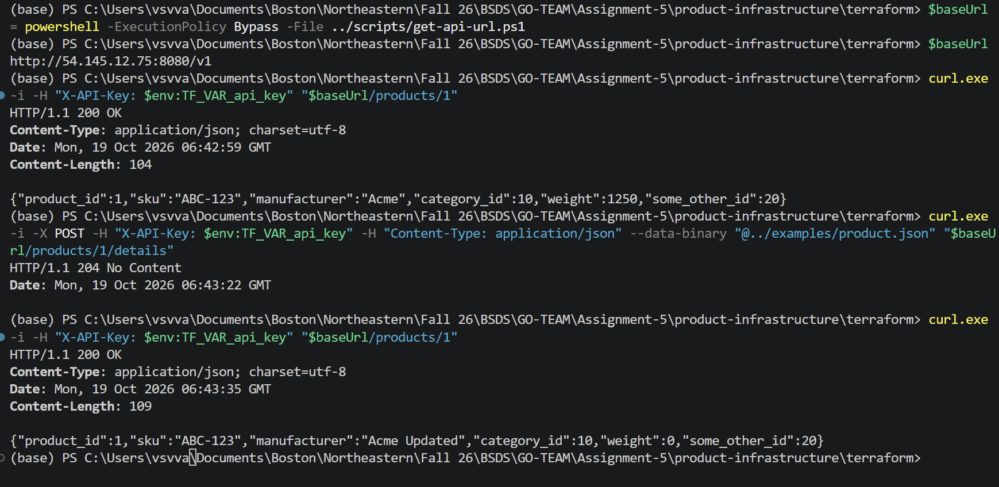

# Part III: Product API on ECS with Terraform

Adapted from [RuidiH/CS6650_2b_demo](https://github.com/RuidiH/CS6650_2b_demo), starting at commit `54246e1fc8caf99cdda879da33b7b5dee3e27b48`. The starter files were reviewed before adaptation.

**Deployment status:** configuration prepared locally. AWS plan/apply and public-endpoint verification must still be performed by the student. This README does not claim an ECS deployment has been completed.

## 1. Fork and save your work

On GitHub, open the starter repository above, select **Fork**, and create the fork under your account. The supplied working folder is currently a clone of the starter, not a GitHub fork. From this folder, connect it to your new fork (replace YOUR-USERNAME):

```powershell
git remote rename origin upstream
git remote add origin https://github.com/YOUR-USERNAME/CS6650_2b_demo.git
git status
git add .
git commit -m "Deploy Product API with Terraform and ECS"
git push -u origin master
```

Run the remote-setup commands only once. Check `git remote -v` if you already set them up. This folder has its own Git history; commit and push here separately from GO-TEAM. Do not add it to GO-TEAM as an accidental embedded repository.

On a different machine:

```powershell
git clone https://github.com/YOUR-USERNAME/CS6650_2b_demo.git
cd CS6650_2b_demo
```

## 2. Prerequisites

Install Git, AWS CLI v2, Terraform >=1.5 and <2.0, and Docker with a running Linux-container engine. Go >=1.25 is needed only for local Go tests; Docker compiles the deployed binary. Commands below are PowerShell commands, usable in PowerShell 7 on other systems too. Use `curl` instead of `curl.exe` on Linux/macOS.

The AWS account must allow ECR, ECS Fargate, CloudWatch Logs, EC2 network queries/security groups, and passing an existing ECS execution role. This starter reuses the default VPC and its subnets; they must have an Internet Gateway route for public tasks to reach ECR. It does not create a VPC, load balancer, NAT gateway, or IAM role.

## 3. Verify the moved Docker build first

From this repository root, with Docker running:

```powershell
docker build --platform linux/amd64 -t product-api:part3-check ./src
docker run --rm --name product-api-part3-check -p 8082:8080 -e API_KEY=local-demo-key -e ENABLE_TEST_ERRORS=true product-api:part3-check
```

In another terminal at the same repository root:

```powershell
powershell -ExecutionPolicy Bypass -File ./examples/test-api.ps1 -BaseUrl http://localhost:8082/v1
```

Then stop the local container with `docker stop product-api-part3-check`. No image archive is stored in the repository: Docker stores the image in its own image store. `src/main.go` was removed, and `src/` contains the Product server, its module files, tests, and the Part II Dockerfile.

## 4. Configure AWS credentials yourself

Start your AWS Academy Learner Lab. Open **AWS Details** and obtain the current temporary AWS CLI credentials. Configure them locally, never in committed Terraform files or chat.

```powershell
aws configure --profile bsds-lab
```

Enter the lab access key, secret key, lab region (usually `us-east-1`; verify yours), and output format `json`. The session token is also required. To avoid placing it literally in a command saved to PowerShell history:

```powershell
$labToken = Read-Host "Paste the current lab session token"
aws configure set aws_session_token $labToken --profile bsds-lab
Remove-Variable labToken
$env:AWS_PROFILE = "bsds-lab"
$env:AWS_REGION = "us-east-1"
aws sts get-caller-identity
```

The identity output must show your intended lab account. Refresh all three credentials when they expire. If old AWS_ACCESS_KEY_ID/AWS_SECRET_ACCESS_KEY/AWS_SESSION_TOKEN environment variables are set, they can override the selected profile; use a fresh terminal or clear those stale values. Keep the same terminal for the remaining commands so the environment variables persist.

Confirm the prerequisites in your account:

```powershell
aws iam get-role --role-name LabRole --query Role.Arn --output text
aws ec2 describe-vpcs --region $env:AWS_REGION --filters Name=is-default,Values=true --query "Vpcs[].VpcId" --output text
```

An empty VPC result means this starter's default-VPC assumption is not satisfied. Outside Learner Lab, provide an existing execution role that trusts ecs-tasks.amazonaws.com and can pull ECR images/write CloudWatch logs (typically AmazonECSTaskExecutionRolePolicy). The app itself needs no task role because it makes no AWS API calls.

## 5. Configure Terraform

```powershell
cd terraform
Copy-Item terraform.tfvars.example terraform.tfvars
```

Edit terraform.tfvars: set the actual lab region and use unique repository/service names if teammates share an account. Keep container_port=8080. The supplied Windows Docker endpoint is `npipe:////./pipe/docker_engine`; on Linux/macOS omit docker_host to use the provider default, or set it to the socket reported by `docker context inspect`. The Docker provider does not necessarily follow your Docker CLI context automatically.

Supply the API key separately:

```powershell
$env:TF_VAR_api_key = Read-Host "Choose an assignment API key (at least 16 characters)"
```

Use only an assignment-specific key. It is masked in Terraform output but is still stored in local state and ECS task configuration. Keep state private; do not commit it. This demo uses HTTP, so do not reuse a real password. `allowed_cidrs` can restrict inbound access to your public IPv4 address followed by `/32`; the starter-compatible default permits public access to port 8080.

## 6. Preview and deploy (you run these)

```powershell
terraform init
terraform fmt -check -recursive
terraform validate
terraform plan -out=deploy.tfplan
terraform show deploy.tfplan
```

Read the plan before applying. Expect a new ECR repository, security group, log group, ECS cluster/task definition/service, and local Docker build/push resources. Existing default networking and the execution role are read rather than created. Investigate unexpected deletion or replacement of existing infrastructure.

```powershell
terraform apply deploy.tfplan
```

Terraform creates ECR, builds the image from src, pushes it, and then starts ECS using the pushed image digest. The service waits for steady state. This creates billable resources while they remain running. Do not run apply against an expired lab session.

## 7. Find the live URL and call the API

Still in terraform/:

```powershell
$cluster = terraform output -raw ecs_cluster_name
$service = terraform output -raw ecs_service_name
$region = terraform output -raw aws_region
aws ecs wait services-stable --region $region --cluster $cluster --services $service
$baseUrl = powershell -ExecutionPolicy Bypass -File ../scripts/get-api-url.ps1
$baseUrl
curl.exe -i -H "X-API-Key: $env:TF_VAR_api_key" "$baseUrl/products/1"
curl.exe -i -X POST -H "X-API-Key: $env:TF_VAR_api_key" -H "Content-Type: application/json" --data-binary "@../examples/product.json" "$baseUrl/products/1/details"
curl.exe -i -H "X-API-Key: $env:TF_VAR_api_key" "$baseUrl/products/1"
```

Expect 200 with the seeded product, 204 with no body, then 200 with the updated product. To demonstrate other ordinary responses:

```powershell
curl.exe -i -H "X-API-Key: $env:TF_VAR_api_key" "$baseUrl/products/99"
curl.exe -i -X POST -H "X-API-Key: $env:TF_VAR_api_key" -H "Content-Type: application/json" --data-binary "@../examples/invalid-product.json" "$baseUrl/products/1/details"
curl.exe -i -X POST -H "X-API-Key: $env:TF_VAR_api_key" -H "Content-Type: application/json" --data-binary "@../examples/missing-product.json" "$baseUrl/products/99/details"
```

Expect GET 404, POST 400, and POST 404 respectively. The public IP can change when ECS replaces the task; rerun get-api-url.ps1 after deployments. The application intentionally has no /albums endpoint and requires the /v1 prefix.

For all seven response codes, temporarily set `enable_test_errors=true` in terraform.tfvars, run plan/apply again, obtain the new URL, then:

```powershell
powershell -ExecutionPolicy Bypass -File ../examples/test-api.ps1 -BaseUrl $baseUrl -ApiKey $env:TF_VAR_api_key
```

The two 500 cases simulate a failure with X-Test-Error: 500. Restore enable_test_errors=false and plan/apply after the demonstration. Normal cloud deployment leaves fault injection disabled.

## 8. Capture the deliverable

Save screenshots of ECS showing the service/task running and curl calling the public endpoint. Add the fork URL, AWS region, cluster/service names, and verification date to your submission README. Do not include credentials or the API key in screenshots; crop/redact the header command if necessary. A running task alone does not prove HTTP connectivity: verify the public GET and POST requests before claiming deployment complete.

## Troubleshooting

- ExpiredToken: refresh the lab access key, secret, and session token; generate a new plan.
- Cannot connect to Docker: start Docker Desktop in Linux mode and check docker_host.
- CannotPullContainerError: check the execution role, ECR image, and public subnet Internet Gateway route.
- Task exits: inspect CloudWatch for startup errors. API_KEY and PORT are supplied by Terraform.
- HTTP timeout: check the task public IP, security-group CIDRs, subnet routes, and port 8080.
- HTTP 401: use the same API key supplied through TF_VAR_api_key.
- Name already exists: use unique names or deliberately import resources you own; do not delete unrelated coursework resources.

Useful diagnostics from terraform/:

```powershell
aws ecs describe-services --region $region --cluster $cluster --services $service --query "services[0].events[:5]"
$logGroup = terraform output -raw log_group_name
aws logs tail $logGroup --region $region --since 10m
```

## Cleanup when grading/demo is finished

Keep the local terraform.tfstate: it maps configuration to real AWS resources. First preview cleanup with `terraform plan -destroy`. ECR refuses to delete nonempty repositories by default. When you explicitly intend to remove this assignment, list and delete only its images using the ECR console, then run `terraform destroy` and review its prompt. No force-delete setting is enabled. Refresh expired credentials before cleanup.

Do not clone onto a second machine and apply against the same deployment without securely transferring its state or configuring a shared backend. For independent teammate deployments, use distinct names and independent state.

## File-by-file explanation and interview notes

| File/directory | Role |
| --- | --- |
| src/product-service.go | Gin routes, validation, map and mutex, required API key, configurable listen port |
| src/go.mod and go.sum | Go dependency versions and integrity checks |
| src/product-service_test.go | Router tests for validation, status codes, updates and authentication |
| src/Dockerfile | Builds the server and copies the binary into a non-root runtime image |
| src/.dockerignore | Limits the Docker build context to image inputs |
| terraform/provider.tf | Selects AWS/Docker plugins, AWS region, Docker socket, and ECR login token |
| terraform/variables.tf | Typed configurable inputs, defaults and validation |
| terraform/main.tf | Connects modules; hashes image inputs, builds/pushes Docker image, passes digest/configuration into ECS |
| terraform/outputs.tf | Exposes cluster/service names, region, port, image tag, ECR URL and log group |
| terraform/terraform.tfvars.example | Non-secret configuration template; actual tfvars is ignored |
| terraform/.terraform.lock.hcl | Locks provider versions and verifies provider packages; commit this |
| modules/network/main.tf | Reads default VPC/subnets; creates API security group |
| modules/network/variables.tf, outputs.tf | Network inputs and subnet/security-group outputs |
| modules/ecr/main.tf | Creates image repository |
| modules/ecr/variables.tf, outputs.tf | Repository-name input and repository-URL output |
| modules/logging/main.tf | Creates CloudWatch log group with retention |
| modules/logging/variables.tf, outputs.tf | Service/retention inputs and log-group-name output |
| modules/ecs/main.tf | Fargate cluster, task definition, service, port, environment and logs |
| modules/ecs/variables.tf, outputs.tf | ECS dependencies/configuration in; cluster/service names out |
| scripts/get-api-url.ps1 | Read-only lookup: service -> running task -> ENI -> public IP |
| examples/ | Curl script and valid/invalid request JSON |
| .gitignore | Excludes providers, state, plans, private configuration, credentials and image archives |

All module paths in the table are relative to terraform/. Terraform loads all .tf files in one directory together; filenames organize the code, not execution order. References create dependencies. For example, ECS's image digest reference ensures the registry push finishes before ECS starts.

What changed from the album starter: replaced src/main.go and its dependencies/Dockerfile with the Product API; kept port 8080 and supplied PORT explicitly; supplied API_KEY; left test faults off by default; renamed resources; made the execution role and Docker socket configurable; upgraded the Docker provider from v2 to v3; built linux/amd64 to match X86_64 Fargate; replaced :latest with a source-derived tag and deployed digest; added steady-state waiting, deployment failure rollback, examples and this guide. The app has no AWS permissions of its own.

An ECS task is one running instance of the task definition (image, CPU/memory, networking and environment). The ECS service keeps the desired task count running. ECR stores images; it does not execute them. CloudWatch stores logs. Products remain in memory, so replacements/restarts reset them; during a rolling update old and new tasks may briefly have different data. This is a coursework deployment, not durable storage.

References: [Terraform AWS tutorial](https://developer.hashicorp.com/terraform/tutorials/aws-get-started), [Terraform documentation](https://developer.hashicorp.com/terraform/docs), [Docker provider](https://registry.terraform.io/providers/kreuzwerker/docker/latest/docs).

## Local verification completed

- Docker image builds from src/ with linux/amd64 targeting.
- Copied Go router tests pass.
- terraform init completed; provider lock file updated (AWS 6.7.0, Docker 3.9.0).
- terraform validate and terraform fmt -check -recursive pass.
- Public-IP helper passes PowerShell syntax parsing; it requires a real deployment to test its AWS queries.
- No Terraform plan/apply or AWS resource changes were performed for this setup. Fork creation, deployment, and public HTTP verification remain student steps.

## Deployed API verification

The screenshot shows the public endpoint, a successful GET (200),
a successful POST update (204), and a second GET (200) confirming
the updated product.

